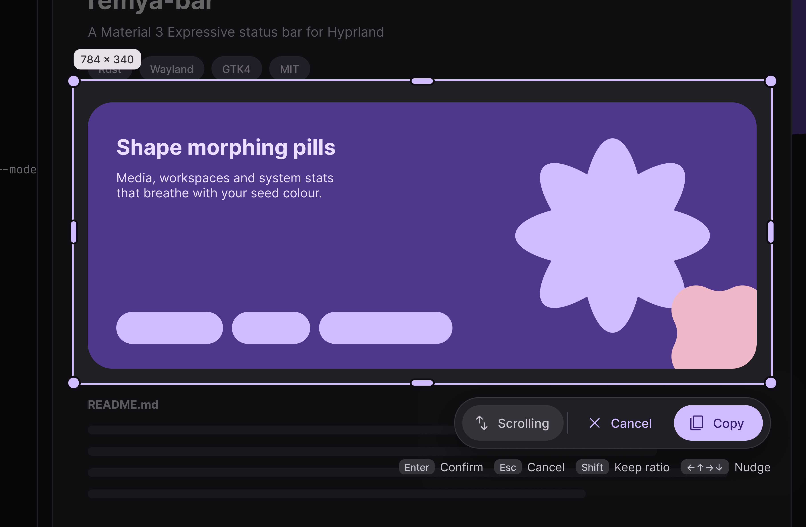
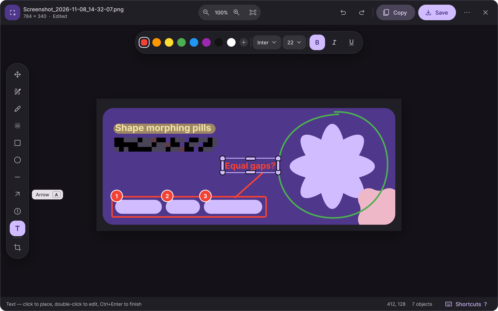
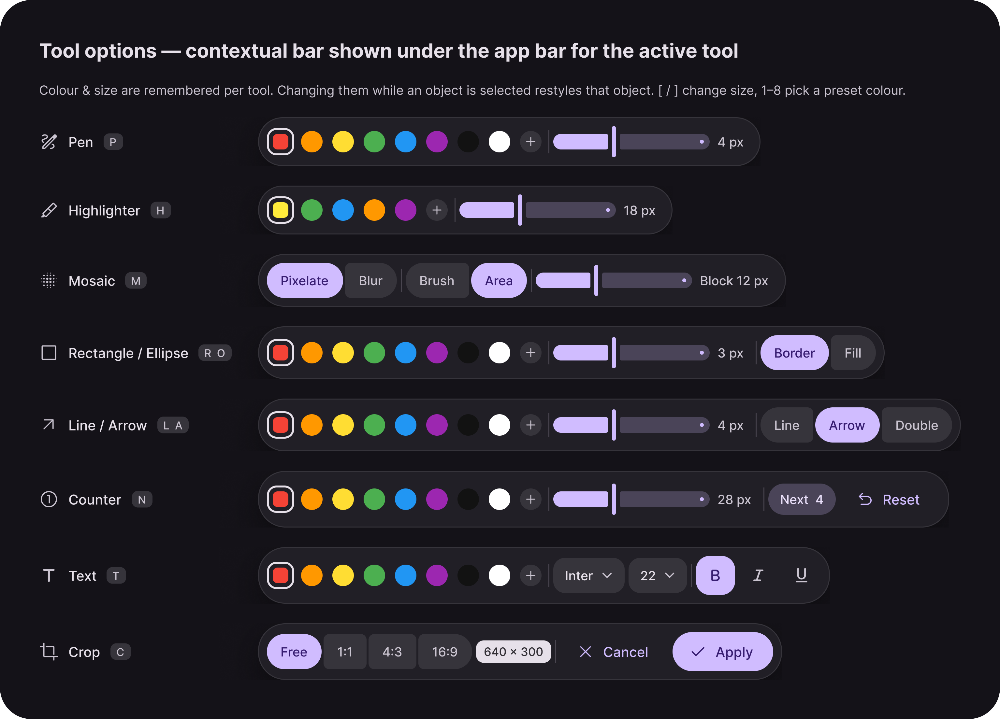
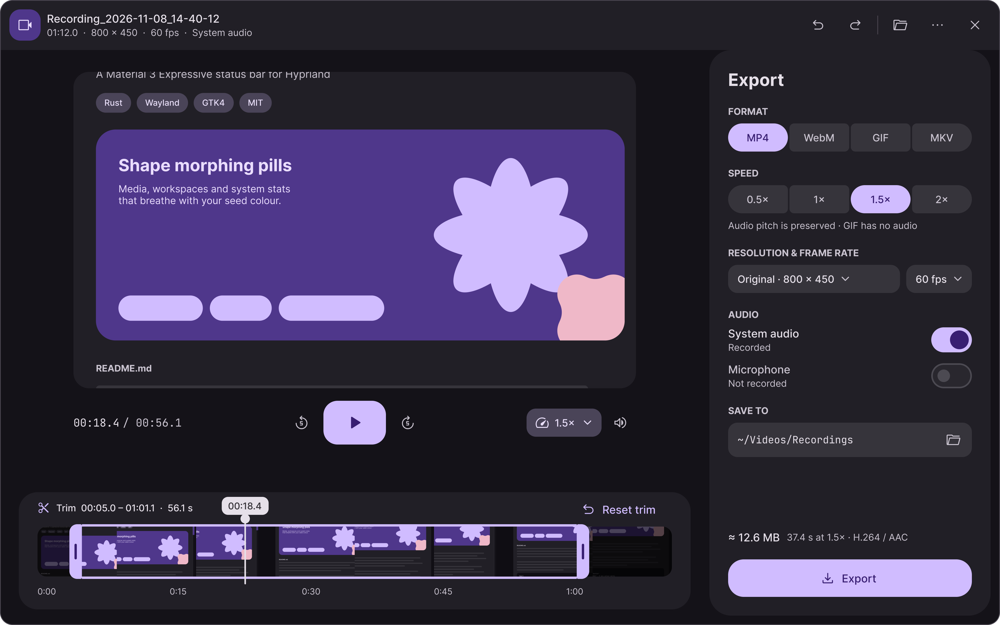
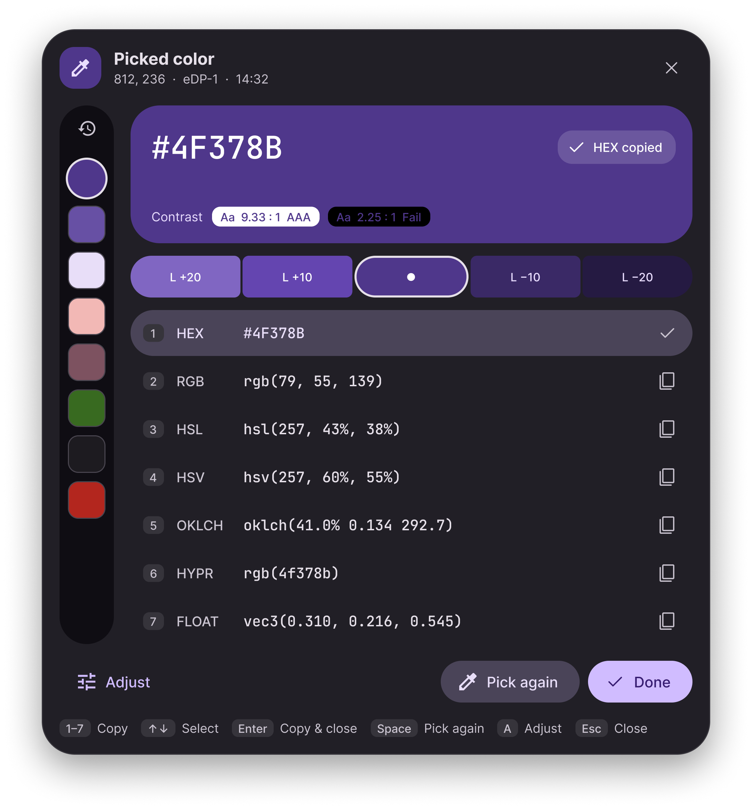

<p align="center">
  
</p>

<h1 align="center">Remy'a Screen Capture</h1>

<h3 align="center">适用于 Arch Linux Hyprland 的截图、录屏与颜色选取工具</h3>

<p align="center">
  
  
  
  
</p>

<p align="center">
  <a href="../README.md">English</a> ·
  <strong>简体中文</strong> ·
  <a href="README.zh-TW.md">繁體中文</a> ·
  <a href="README.ru.md">Русский</a> ·
  <a href="README.de.md">Deutsch</a> ·
  <a href="README.es.md">Español</a> ·
  <a href="README.ja.md">日本語</a>
</p>

以 **Material Design 3 Expressive** 打造的现代优雅界面，兼顾**键盘优先**的高效交互与**丰富的内置编辑能力**——从采集到后期处理一气呵成。

- **键盘优先体验**：完备的快捷键支持，打造高效工作流。
- **MD3E 优雅设计**：遵循 Material Design 3 Expressive 规范，具备细腻流畅的动效与清晰克制的视觉层次，原生融入 Hyprland 桌面美学。
- **丰富内置编辑**：完整覆盖截图批注、视频剪辑与取色器面板功能。

> [!WARNING]
> 本软件目前处于 **Beta** 阶段，可能存在错误与不稳定性，部分功能与行为仍在持续完善中。

## 🚀 安装

### 通过 AUR 安装

使用你常用的 AUR 助手安装 `remya-screen-capture`：

```bash
paru -S remya-screen-capture || yay -S remya-screen-capture
```

### Hyprland 快捷键配置

将快捷键绑定添加到 Hyprland 配置中（若 `~/.local/bin` 不在会话的 `PATH` 中，请填写可执行文件的绝对路径），以下为配置示例：

```lua
-- 屏幕截图
hl.bind("SUPER + SHIFT + S", hl.dsp.exec_cmd("remya_screen_capture"))

-- 屏幕录制
hl.bind("SUPER + R", hl.dsp.exec_cmd("remya_screen_capture --record"))

-- 取色器
hl.bind("SUPER + SHIFT + C", hl.dsp.exec_cmd("remya_screen_capture --color-picker"))
```

## ✨ 功能一览

### 屏幕截图

| 屏幕截图                                          | 标注编辑器                                                 |
|:-------------------------------------------------:|:----------------------------------------------------------:|
|  |  |

<p align="center">
  
</p>

- **全场景捕获**：支持窗口截图、自定义区域截图以及自动垂直滚动长截图（基于 `zwlr_virtual_pointer_v1` 协议自动滚动并拼接）。
- **精细化选区**：支持鼠标拖拽与键盘像素级微调。
- **内置编辑器**：提供丰富的绘图与标注工具。

### 屏幕录制

<p align="center">
  
</p>

- **录制中实时标注**：支持录屏过程中使用画笔与激光笔工具。
- **内置视频剪辑与多格式导出**：支持逐帧步进预览与精确区间裁剪；支持导出为 MP4、WebM、GIF 或 MKV，并可将独立的系统音频与麦克风音轨混合输出。

### 取色器

<p align="center">
  
</p>

- **专业色彩分析与编辑**：实时展示多种颜色格式、对比度与色阶，支持 HSL 色彩微调与历史记录回溯。

## ⌨️ 开发指南

### 技术栈与架构

- **Flutter**：通过 FVM 锁定为 `3.47.9`，采用 Material Design 3 Expressive（`material_ui: ^1.5.0`）。
- **Rust**：`2024` edition，通过根目录 `rust-toolchain.toml` 以 Cargo workspace 管理。
- **FFI**：`flutter_rust_bridge` `2.13.0`，Linux 构建会打包 Rust 截图库。
- **录屏与视频**：使用系统 GPU Screen Recorder 采集画面，libmpv 进行预览，FFmpeg 负责导出。
- **设置集成**：公共 `remya_settings_client` 包，预留用于后续集成。
- **目录结构**：
  - `lib/main.dart` 与 `lib/app.dart`：应用启动与主题配置。
  - `lib/features/`：截图 UI、图像编辑器及可复用采集控件。
  - `lib/src/rust/capture/`：Wayland 采集命令、PNG 处理与自动滚动捕获（新增 `wayland-client` 与 `wayland-protocols-wlr` 依赖）。Rust 依赖许可请参见其中的第三方声明。
  - `linux/`：Linux GTK 运行器与桌面打包配置。
  - `assets/icons/`：应用图标。
  - `tool/install.py`：XDG 安装辅助脚本。

### 构建环境准备

- 安装有 Flutter SDK `3.47.9` 的 FVM
- 通过 `rustup` 管理的 Rust 工具链
- Flutter Linux 构建依赖
- 在 Arch Linux 上安装运行与原生构建依赖：

```bash
sudo pacman -S grim wl-clipboard gtk-layer-shell wayland wayland-protocols inter-font fontconfig
# 录屏与视频编辑依赖
sudo pacman -S gpu-screen-recorder ffmpeg mpv libepoxy
```

- 同级目录需包含提供 `packages/remya_settings_client` 的 `../remya-settings` 仓库检出

```bash
fvm install
fvm flutter pub get
```

修改 Rust 桥接 API 后，请使用 `flutter_rust_bridge_codegen` 2.13.0 重新生成绑定，并运行 `fvm dart format lib/src/rust_bridge`。

### 验证与本地安装

```bash
# Dart 格式化、静态分析与测试
fvm dart format --output=none --set-exit-if-changed lib test
fvm flutter analyze
fvm flutter test

# Rust 格式化、Lint 与测试
cargo fmt --all -- --check
cargo clippy --workspace --all-targets -- -D warnings
cargo test --workspace

# Linux 应用调试构建
fvm flutter build linux --debug

# 发布构建并安装到本地 XDG 目录
fvm flutter build linux --release
python3 tool/install.py
```

## 📜 许可证

本项目基于 [PolyForm Noncommercial License 1.0.0](../LICENSE) 开源。
